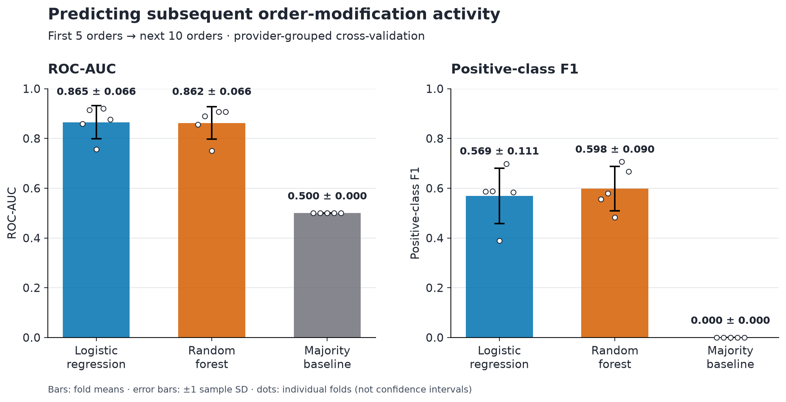
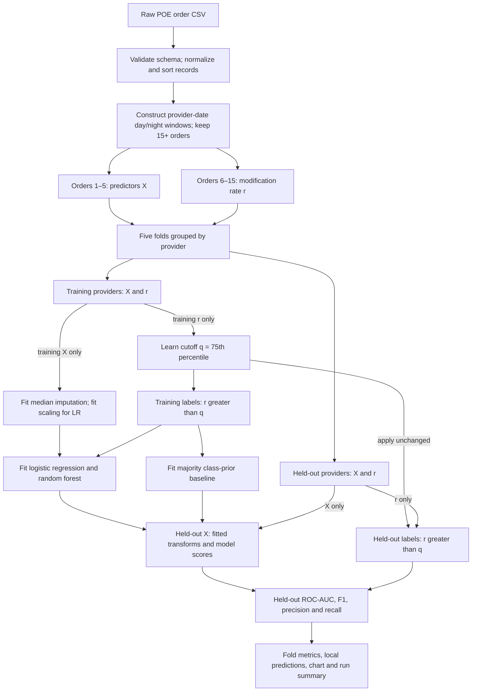

# CogniShift

**Can a provider’s first five orders predict elevated modification activity in their next ten?**

**2026 Purdue Innovation Challenge — Best Overall Integration** · Built by Catalyst Crew

| Logistic regression ROC-AUC | Analyzed orders | Eligible shifts¹ | Providers | Evaluation |
| :---: | :---: | :---: | :---: | :---: |
| **0.865** | **44,362** | **789** | **478** | **5 provider-grouped folds** |

CogniShift turns timestamped order logs into an explicit prediction problem: summarize orders 1–5, then classify elevated `Change` / `D/C` activity in orders 6–15. Logistic regression and random forest are evaluated on providers excluded from training. The target measures **order-modification activity**, not fatigue, errors, or clinical risk.

¹ Shifts are constructed provider-date day/night windows, not verified staffing shifts. Tied timestamps also limit any claim of prospective lead time; see [limitations](#limitations).



## Results

| Model | ROC-AUC, mean ± SD | Positive-class F1, mean ± SD |
| --- | ---: | ---: |
| Logistic regression | **0.865 ± 0.066** | 0.569 ± 0.111 |
| Random forest | 0.862 ± 0.066 | **0.598 ± 0.090** |
| Majority baseline | 0.500 ± 0.000 | 0.000 ± 0.000 |

These are unweighted means over five held-out-provider folds. Error bars show sample SD across folds, **not confidence intervals**. Both models are reported; the small AUC difference does not establish superiority. The baseline returns the training class prior and predicts the negative class at 0.5 in every fold, hence zero positive-class F1.

The local extract contains 45,154 rows; 792 missing-provider rows are excluded. Every training fold has a 75th-percentile modification-rate cutoff of 0.30, so high activity means **at least 4 modifications among the next 10 orders**. Held-out positive prevalence ranges from 15.2% to 20.9%. See the [per-fold evidence](docs/results/fold_metrics.csv) and [run summary](docs/results/run_summary.json). **Reproducing the original 0.865 ROC-AUC requires separately obtaining authorized MIMIC-IV data and the original extract.** Restricted clinical inputs are not distributed. The synthetic example below is a separate demonstration and does not reproduce this score.

## Approach and architecture

Twelve predictors describe early modifications, order-type diversity and entropy, task switches, timing gaps and rate, medication share, cyclical start time, and weekend status. Provider identifiers and outcome-window events never enter the feature matrix.



Each fold learns its outcome cutoff **only from training rates** and applies the same cutoff to held-out rates. Fresh pipelines fit imputation and scaling only on training predictors. Held-out outcomes are used to score predictions, never to fit preprocessing, thresholds, or models. Records are sorted by timestamp; equal timestamps retain input row order.

The implementation separates responsibilities without adding a framework:

```text
cognishift/
├── __main__.py       # python -m cognishift
├── cli.py            # arguments, execution and exports
├── data.py           # input validation and shift assignment
├── features.py       # first-five features and next-ten outcome
├── evaluation.py     # models and provider-grouped cross-validation
├── reporting.py      # aggregate comparison figure
└── synthetic.py      # deterministic, entirely artificial orders
tests/                # synthetic unit and CLI integration tests
docs/
├── methodology.md    # feature definitions, protocol and interpretation
└── results/          # curated aggregate evidence; no provider records
data/README.md        # input schema, provenance and access requirements
pyproject.toml        # installation and development tooling
requirements-lock.txt # exact verified environment
.github/workflows/ci.yml
```

Full feature definitions and model settings are in [the methodology](docs/methodology.md).

## Reproduce

Use **Python 3.14**. This is the tested version; other Python versions are not currently claimed as supported.

```bash
git clone https://github.com/dalal35/Cogni-Shift.git
cd Cogni-Shift
python3.14 -m venv .venv
source .venv/bin/activate
python -m pip install -r requirements-lock.txt
python -m pip install --no-deps -e .
python -m cognishift --synthetic --output-dir outputs/demo
```

On Windows PowerShell, create the environment with `py -3.14 -m venv .venv` and activate with `.venv\Scripts\Activate.ps1`. Windows execution has not been verified.

For a normal installation with compatible dependency versions, use `python -m pip install -e ".[dev]"` instead of the two installation commands. The lock file records the environment used to verify published results; alternate dependency versions can change floating-point outputs or splits.

```bash
python -m unittest discover -s tests -v
ruff check .
ruff format --check .
python -m cognishift --help
```

CI runs formatting, linting, tests, and a synthetic evaluation without clinical data.

To rerun the reported evaluation, obtain an **authorized copy of the original extract** and follow the [four-column input schema](data/README.md):

```bash
python -m cognishift --input /path/to/authorized/poe.csv --output-dir outputs/evaluation
```

`python -m cognishift` defaults to `data/poe.csv` and `outputs/`. Input and output paths are configurable from any working directory after installation. The command exports `grouped_cv_metrics.csv`, `grouped_cv_predictions.csv`, `grouped_cv_scores.png`, and `run_summary.json`. A repeat run replaces those files. Predictions contain provider identifiers and remain local; generated files and restricted inputs are ignored by Git. Only reviewed aggregate evidence is curated under `docs/results/`.

The optional [`decision_fatigue_dataset.csv`](data/decision_fatigue_dataset.csv) is a separate, synthetic behavioral dataset from Kaggle, verified as **CC0: Public Domain**. It is not used by the current evaluator or required for the built-in synthetic demonstration. See [source, license, and checksum verification](data/README.md#behavioral-dataset-license-verification).

## Limitations

- **Record sequence is not prospective lead time.** In 604 of 789 eligible windows (76.6%), order 5 and order 6 have the same timestamp. Stable input row order defines their boundary. Predictor and outcome records are disjoint, but the evaluation does not establish that a warning could precede the outcome in real time.
- **Constructed shifts are an approximation.** Every eligible window in this extract contains one patient, so it does not establish a provider’s complete workload. The source is described as MIMIC-IV, whose [patient-specific date shifts](https://physionet.org/content/mimiciv/3.1/) prevent reconstructing cross-patient chronology without additional provenance. Actual staffing schedules are unavailable.
- **Selection and generalization remain open.** Eligibility requires 15 orders, using later record availability. Providers are held out, but patients, institutions, and future time periods are not independently held out. There is no prospective or external validation, and no separate final test set after comparing models.
- **Scores are not calibrated clinical probabilities.** Class-balanced training and a fixed 0.5 decision threshold support the reported classification experiment, not a validated risk score. Order modifications can be routine actions.
- **Clinical data access is restricted.** MIMIC-IV inputs and provider-level outputs are excluded from this release. Researchers must obtain their own authorized access; the original extraction query and release version are not recorded, so another extract may produce different results. See [data handling](data/README.md#provenance-and-publishing).

The project began with exploratory behavioral-to-clinical transfer and provider-relative scoring. Those unvalidated proxies are not evidence for the results above. Superseded scripts and versioned plots remain recoverable from earlier commits and the private local archive. The historical [browser prototype](outputs/doctor_fatigue_simulator.html) uses hard-coded profiles and heuristic scores; it is not connected to this evaluator, and its displayed fatigue/error probabilities are not validated results. The next useful research step is validating real chronology and extraction provenance before extending the models.

## Contributors

Developed by **Catalyst Crew**, including **Yash Dalal** and **Sri Dhruti Sirigibathina**. Recognition and development credit belong to the team; the repository does not establish a verified division of individual responsibilities. Award title and year are supplied by the project team.
