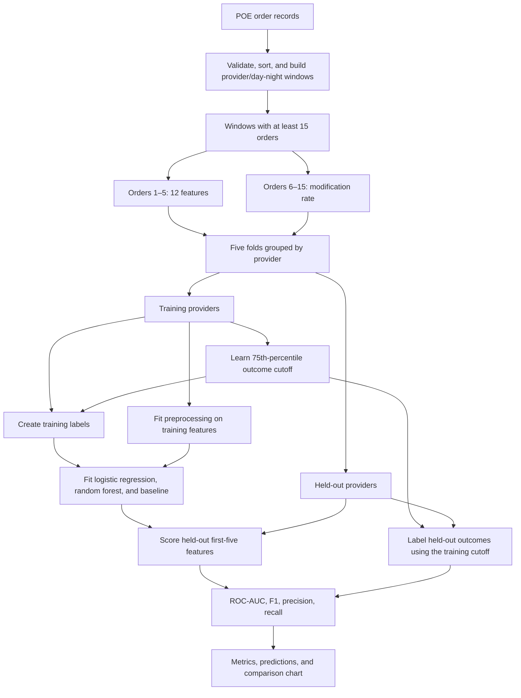

<h1 align="center">CogniShift</h1>

<p align="center"><strong>Can the first five orders help predict how often the next ten will be changed?</strong></p>

<p align="center">
  <strong>Best Overall Integration</strong> · 2026 Purdue Innovation Challenge · Catalyst Crew
</p>

<p align="center">
  
  
  
  <a href="https://github.com/dalal35/Cogni-Shift/actions/workflows/ci.yml"></a>
</p>

| **0.865** | **44,362** | **789** | **478** | **5 folds** |
| :---: | :---: | :---: | :---: | :---: |
| Mean ROC-AUC | Orders analyzed | Eligible windows | Providers | Grouped by provider |

Order changes are a normal part of clinical work. We wanted to know whether the pattern in a provider's first few orders carried any signal about what happened next.

CogniShift turns order logs into a classification task: use **orders 1–5** to predict elevated `Change` or `D/C` activity in **orders 6–15**. We compared logistic regression and random forest against a simple baseline, keeping providers in separate training and evaluation folds.

This is a retrospective study of **order-modification activity**, not a model of clinician fatigue, medical errors, or patient risk.

## Results


| Model | ROC-AUC (mean ± SD) | Positive-class F1 (mean ± SD) |
| --- | ---: | ---: |
| **Logistic regression** | **0.865 ± 0.066** | 0.569 ± 0.111 |
| Random forest | 0.862 ± 0.066 | **0.598 ± 0.090** |
| Majority-class baseline | 0.500 ± 0.000 | 0.000 ± 0.000 |

Results are averages across five folds with providers held out from training. The ± values show fold-to-fold standard deviation, not confidence intervals. The two models perform similarly on ROC-AUC, so the small difference isn't enough to call either one better overall.

In each training fold, we defined “elevated” activity as a modification rate above the training set's 75th percentile. That cutoff was 0.30 in this evaluation, corresponding to **at least four modifications among the next ten orders**. The held-out positive rate ranged from 15.2% to 20.9%.

The detailed numbers are in [fold_metrics.csv](docs/results/fold_metrics.csv) and [run_summary.json](docs/results/run_summary.json).

## How it works

Each eligible provider/day-night window supplies two nonoverlapping sequences:

- **First five orders:** 12 features covering early modifications, order types, task switching, timing, and time of day.
- **Next ten orders:** the proportion marked `Change` or `D/C`, used only to define and evaluate the outcome.

We split the data into five folds by provider so the same provider never appears on both sides of a fold. The modification-rate threshold and preprocessing are fitted on training data only.



No information from orders 6–15 is included in the model's input features. Those orders are used to evaluate the prediction. This separation matters, although tied timestamps create an important limitation discussed [below](#limitations).

For the feature definitions, model settings, and evaluation protocol, see [Methodology](docs/methodology.md).

## Run it yourself

The project was tested with **Python 3.14**. It includes a synthetic dataset generator, so you can run the complete pipeline without access to clinical records.

```bash
git clone https://github.com/dalal35/Cogni-Shift.git
cd Cogni-Shift
python3.14 -m venv .venv
source .venv/bin/activate
python -m pip install -r requirements-lock.txt
python -m pip install --no-deps -e .
python -m cognishift --synthetic --output-dir outputs/demo
```

On Windows PowerShell, use `py -3.14 -m venv .venv` and `.venv\Scripts\Activate.ps1` for the environment setup. Windows execution has not been tested.

The synthetic run writes a metrics CSV, prediction CSV, comparison chart, and run summary to `outputs/demo/`. Its scores are **not** the reported 0.865 ROC-AUC, which comes from the original research extract.

### Run the tests

```bash
python -m pip install -e ".[dev]"
python -m unittest discover -s tests -v
ruff check .
ruff format --check .
```

GitHub Actions runs linting, tests, and the synthetic evaluation without clinical data.

### Run the research evaluation

The reported results came from a MIMIC-IV-derived POE extract. The underlying data cannot be redistributed with this repository. Researchers with authorized access can place a compatible CSV locally and run:

```bash
python -m cognishift --input /path/to/authorized/poe.csv --output-dir outputs/evaluation
```

See [Data requirements](data/README.md) for the four input columns and provenance notes. Reproducing the exact published numbers requires the same extract; the extraction query and release version are not available in this repository.

## Project layout

```text
cognishift/
├── cli.py          # Command-line interface and output paths
├── data.py         # Input checks and provider windows
├── features.py     # Early-order features and later-order outcome
├── evaluation.py   # Models and provider-grouped validation
├── reporting.py    # Figures and summaries
├── synthetic.py    # Reproducible example data
└── __main__.py     # python -m cognishift
tests/               # Unit and integration tests
docs/
├── methodology.md  # Feature definitions and evaluation details
└── results/        # Aggregate metrics and comparison figure
data/README.md       # Data schema, access, and provenance
pyproject.toml       # Package and development configuration
requirements-lock.txt
.github/workflows/ci.yml
```

The main workflow runs with `python -m cognishift`. You can also use `python -m cognishift --help` for available options.

## Limitations

A strong retrospective ROC-AUC does **not** mean this is ready to make real-time clinical predictions. There are several important reasons:

- **Order sequence is not necessarily elapsed time.** In 604 of 789 eligible windows (76.6%), the fifth and sixth orders share a timestamp. We preserve input row order for ties, but cannot show that a prediction would have preceded the outcome in real time.
- **These aren't confirmed staffing shifts.** We construct day/night windows from timestamps. Every eligible window in this extract contains orders for one patient, so the analysis does not represent a provider's full workload. MIMIC-IV also shifts dates at the patient level, complicating cross-patient chronology.
- **The evaluation is limited to this extract.** We require at least 15 orders in a window, which selects cases using later availability. Holding out providers is useful, but it isn't the same as validation at another hospital or in a future time period.
- **Modification activity is not a clinical outcome.** A changed or discontinued order can be routine. Model scores have not been calibrated or validated as measures of fatigue, medical error, or patient risk.

These questions about chronology and generalization are the main things we would want to address before taking the work beyond retrospective analysis.

## Team

CogniShift was developed by **Catalyst Crew**, including **Yash Dalal** and **Sri Dhruti Sirigibathina**, for the **2026 Purdue Innovation Challenge**, where the team received **Best Overall Integration**.
